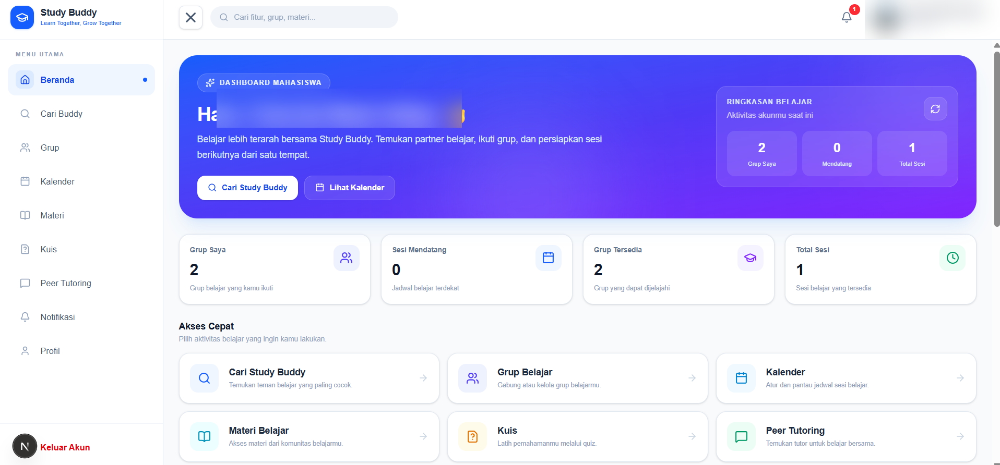
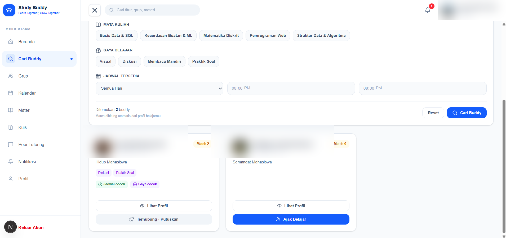
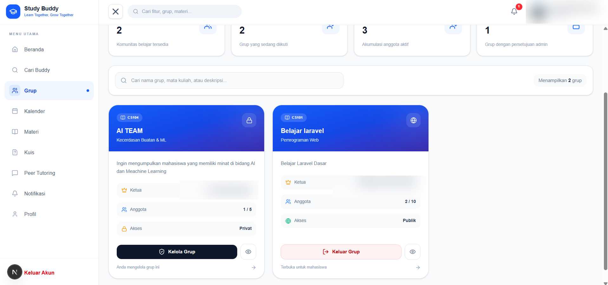
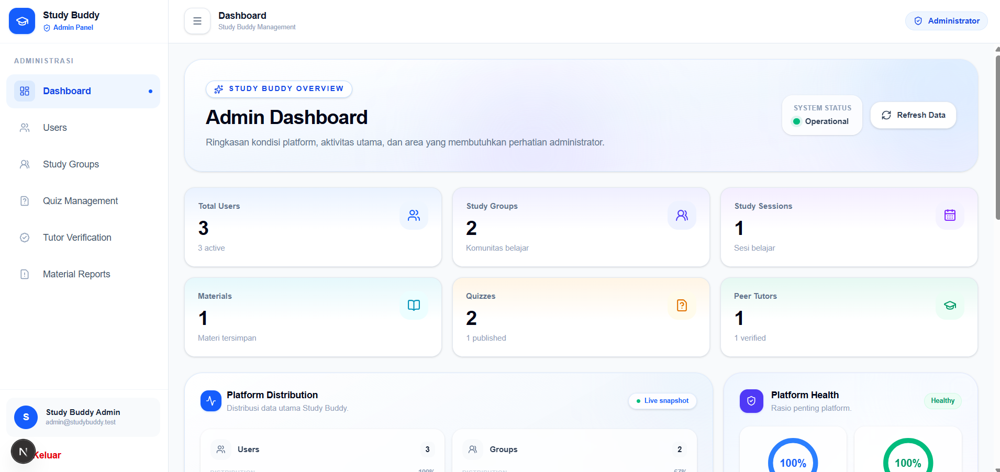

# Study Buddy 🎓

**Study Buddy** adalah platform belajar kolaboratif untuk mahasiswa: mencari partner belajar, mengelola grup dan jadwal belajar, berbagi materi, mengerjakan kuis, serta melakukan *peer tutoring*. Tersedia panel administrator untuk pemantauan dan moderasi aktivitas.

> **Status:** panduan ini ditujukan untuk menjalankan aplikasi di lingkungan **development lokal** menggunakan Docker Compose, bukan panduan deployment production. Contoh kredensial di repository hanya untuk pengembangan dan harus diganti sebelum aplikasi dipublikasikan.

## Daftar Isi

- [Fitur](#fitur)
- [Tech Stack](#tech-stack)
- [Struktur Proyek](#struktur-proyek)
- [Persyaratan](#persyaratan)
- [Cara Menjalankan (Docker)](#cara-menjalankan-docker)
- [Akun Demo](#akun-demo)
- [Screenshot](#screenshot)
- [Menjalankan Pengujian](#menjalankan-pengujian)
- [Troubleshooting](#troubleshooting)
- [Keamanan dan Kontribusi](#keamanan-dan-kontribusi)

## Fitur

### Mahasiswa

- **Autentikasi & Profil** — registrasi, login, logout, pengelolaan profil, bidang studi, dan preferensi belajar.
- **Cari Buddy** — pencarian dan pencocokan partner belajar berdasarkan profil, minat, serta ketersediaan; kirim dan kelola permintaan koneksi.
- **Grup Belajar** — membuat grup, mencari grup, bergabung/mengajukan permintaan bergabung, dan mengelola anggota.
- **Kalender & Study Session** — membuat dan mengikuti sesi belajar terjadwal.
- **Materi Belajar** — unggah, cari, unduh, dan kelola materi pembelajaran.
- **Kuis** — mengerjakan kuis, melihat hasil, serta mengelola kuis yang dibuat.
- **Peer Tutoring** — mencari tutor sebaya, mengatur profil tutor, mengajukan sesi, dan memberikan ulasan.
- **Notifikasi** — memantau pemberitahuan aktivitas belajar.

### Administrator

- Dashboard ringkasan aktivitas platform.
- Manajemen pengguna dan grup belajar.
- Moderasi kuis, verifikasi tutor, dan penanganan laporan materi.

## Tech Stack

| Bagian | Teknologi |
| --- | --- |
| Frontend | Next.js 16.3.5, React 19, TypeScript, Tailwind CSS 4 |
| Backend/API | Laravel 13, PHP 8.4 (image Docker), Laravel Sanctum |
| Database | PostgreSQL 16 |
| Infrastruktur lokal | Docker Compose |
| Package manager | Composer (backend), npm (frontend) |

Frontend menggunakan API relatif **`/api/v1`**. Next.js me-*rewrite* request `/api/*` ke service Laravel `backend:8000` di jaringan Docker. Karena itu, browser cukup mengakses frontend di `localhost:3000` tanpa mengubah URL API ke alamat container.

## Struktur Proyek

```text
Deny-Project2-StudyBuddy/
├── backend/                 # Laravel REST API, migrasi, seeder, pengujian
│   ├── app/
│   ├── database/
│   ├── routes/api.php
│   ├── .env.example
│   └── Dockerfile
├── frontend/                # Next.js (mahasiswa dan admin)
│   ├── app/
│   ├── lib/
│   ├── .env.example
│   └── Dockerfile
├── docs/screenshots/        # Tangkapan layar fitur
├── .env.example             # Variabel Docker Compose (sumber konfigurasi utama)
├── docker-compose.yml
└── README.md
```

## Persyaratan

- **Git** untuk meng-*clone* repository.
- **Docker Desktop** (Windows/macOS) atau Docker Engine + **Docker Compose v2** (Linux). Pastikan Docker sedang berjalan.
- Koneksi internet saat pertama kali membangun image dan memasang dependensi.
- Port lokal **3000**, **8000**, dan **5432** tidak sedang digunakan aplikasi lain.

> Dengan Docker, kamu **tidak perlu memasang PHP, Composer, Node.js, atau PostgreSQL langsung** di komputer. Seluruh dependensi aplikasi berjalan di container.

## Cara Menjalankan (Docker)

Jalankan perintah di **terminal pada folder root repository** (folder yang berisi `docker-compose.yml`).

### 1. Clone repository

```bash
git clone https://github.com/Central-Saga/Deny-Project2-StudyBuddy.git
cd Deny-Project2-StudyBuddy
```

### 2. Siapkan konfigurasi `.env`

**Windows PowerShell:**

```powershell
Copy-Item .env.example .env
```

**macOS / Linux / Git Bash:**

```bash
cp .env.example .env
```

Buka file `.env` di root proyek menggunakan editor teks, lalu **ganti** minimal nilai berikut dengan nilai khusus development lokal:

```dotenv
DB_PASSWORD=buat_password_database_lokal_sendiri
ADMIN_PASSWORD=buat_password_admin_lokal_sendiri
```

`APP_KEY` boleh dibiarkan kosong **sementara**; akan diisi pada langkah 4. Jangan mengunggah file `.env` ke GitHub. File `backend/.env.example` dan `frontend/.env.example` adalah referensi konfigurasi masing-masing aplikasi; **untuk Docker Compose cukup buat `.env` di root** karena konfigurasi diteruskan ke container.

### 3. Build image Docker

```bash
docker compose build
```

Proses pertama mungkin memerlukan beberapa menit. Build frontend menjalankan `npm install`; build backend menjalankan `composer install`.

### 4. Buat Laravel `APP_KEY`

Jalankan:

```bash
docker compose run --rm --no-deps backend php artisan key:generate --show
```

Salin nilai yang muncul (diawali `base64:`), lalu tempel ke **file `.env` di root**:

```dotenv
APP_KEY=base64:HASIL_PERINTAH_DI_ATAS
```

**Penting:** perintah `--show` hanya menampilkan key, **tidak otomatis mengisi `.env` root**. Jangan menyalin key contoh dari internet atau menyimpannya di `.env.example`.

### 5. Jalankan container

```bash
docker compose up -d
```

Periksa status service:

```bash
docker compose ps
```

Tiga service yang digunakan: `backend`, `frontend`, dan `db` (PostgreSQL). Database perlu beberapa detik untuk siap pada start pertama.

### 6. Migrasi dan isi data awal

```bash
docker compose exec backend php artisan migrate --force
docker compose exec backend php artisan db:seed --force
docker compose exec backend php artisan storage:link
```

Seeder bawaan membuat mata kuliah contoh, **dua akun mahasiswa demo**, dan **satu akun administrator**. Perintah `db:seed` untuk data mahasiswa sebaiknya dijalankan **sekali pada database baru**, karena `UserSeeder` membuat pengguna dengan `create()` dan dapat menyebabkan duplikasi email jika dijalankan berulang.

### 7. Buka aplikasi

| Halaman | Alamat |
| --- | --- |
| Login | http://localhost:3000/login |
| Registrasi | http://localhost:3000/register |
| Dashboard mahasiswa (perlu login) | http://localhost:3000/dashboard |
| Dashboard admin (perlu akun admin) | http://localhost:3000/admin |
| Backend Laravel | http://localhost:8000 |
| API login | `POST http://localhost:8000/api/v1/login` |

> **Catatan:** halaman `/` frontend dalam snapshot kode ini masih menggunakan halaman bawaan Next.js. Gunakan **`/login`** untuk mulai memakai Study Buddy.

### 8. Periksa aplikasi

- Login menggunakan akun demo di bawah.
- Coba buka **Cari Buddy**, **Grup**, **Kalender**, **Materi**, **Kuis**, dan **Peer Tutoring**.
- Login sebagai admin lalu buka `/admin` untuk memeriksa dashboard dan menu moderasi.
- Jika ada masalah, lihat log dengan `docker compose logs -f backend` atau `docker compose logs -f frontend` (tekan `Ctrl+C` untuk berhenti mengikuti log).

### Menghentikan dan menjalankan kembali

```bash
docker compose stop       # berhenti sementara, data database tetap tersimpan
docker compose start      # jalankan kembali
docker compose down       # hapus container/jaringan, volume database tetap tersimpan
```

**Jangan gunakan `docker compose down -v`** kecuali sengaja ingin menghapus volume dan seluruh data PostgreSQL lokal.

## Akun Demo

Akun berikut dibuat oleh `backend/database/seeders/UserSeeder.php` dan `AdminSeeder.php` setelah langkah `db:seed`:

| Role | Email | Password |
| --- | --- | --- |
| Mahasiswa — Budi Santoso | `budi@example.com` | `password123` |
| Mahasiswa — Siti Aminah | `siti@example.com` | `password123` |
| Admin | `admin@studybuddy.test` (nilai awal `ADMIN_EMAIL`) | Nilai `ADMIN_PASSWORD` pada file `.env` root |

Akun dan password ini hanya untuk **development/demo**, bukan akun pengguna sungguhan. **Ganti `ADMIN_PASSWORD` di `.env` sebelum menjalankan seeder**. Jika mengubahnya setelah seeder dijalankan, password admin yang tersimpan di database tidak otomatis berubah.

## Screenshot

Tangkapan layar berikut berasal dari sesi pengembangan aplikasi (data identitas ditutupi untuk privasi). Tampilan dan jumlah data dapat berbeda pada instalasi baru karena data demo yang tersedia lebih sedikit.

**Dashboard Mahasiswa**



**Cari Buddy dan Grup Belajar**

| Cari Buddy | Grup Belajar |
| --- | --- |
|  |  |

**Fitur lainnya:** [Kalender](docs/screenshots/calendar.png) · [Materi](docs/screenshots/materials.png) · [Kuis](docs/screenshots/quiz.png) · [Peer Tutoring](docs/screenshots/tutoring.png) · [Dashboard Admin](docs/screenshots/admin.png)

<details>
<summary>Lihat screenshot Dashboard Admin</summary>



</details>

## Menjalankan Pengujian

Pengujian Laravel menggunakan **database PostgreSQL terpisah** bernama `study_buddy_test`, sebagaimana dikonfigurasi di `backend/phpunit.xml`. Jangan arahkan test ke database utama `study_buddy_db`.

**1. Buat database test (cukup sekali):**

```bash
docker compose exec db createdb -U studybuddy_user study_buddy_test
```

Jika sudah pernah dibuat, perintah `createdb` akan memberi pesan bahwa database sudah ada; langkah ini bisa dilewati. Jika mengubah `DB_USERNAME` di `.env`, sesuaikan `-U` dengan username tersebut.

**2. Jalankan test backend:**

```bash
docker compose exec backend php artisan test
```

**3. Periksa build dan lint frontend:**

```bash
docker compose exec frontend npm run build
docker compose exec frontend npm run lint
```

**4. Periksa route API (opsional):**

```bash
docker compose exec backend php artisan route:list --path=api/v1
```

> Jangan menyatakan semua test berhasil sebelum perintah-perintah tersebut benar-benar dijalankan pada mesin lokal.

## Troubleshooting

| Masalah | Solusi |
| --- | --- |
| `docker compose` tidak dikenal | Pastikan Docker Desktop / Docker Compose v2 terpasang dan berjalan. |
| Port `3000`, `8000`, atau `5432` sudah digunakan | Tutup service yang memakai port tersebut atau ubah pemetaan port host pada `docker-compose.yml`. |
| Database gagal start / `POSTGRES_PASSWORD` kosong | Pastikan `.env` **root** sudah dibuat dan `DB_PASSWORD` berisi nilai non-kosong sebelum `docker compose up`. |
| `No application encryption key has been specified` | Isi `APP_KEY` pada `.env` root sesuai langkah 4, kemudian jalankan `docker compose up -d --force-recreate backend`. |
| Backend tidak bisa terhubung ke database | Tunggu `db` sehat (`docker compose ps`), lalu periksa `DB_HOST=db`, `DB_PORT=5432`, dan kredensial pada `.env` root. |
| `vendor/autoload.php` tidak ditemukan | Periksa hasil `docker compose build backend`; pastikan Composer selesai memasang dependensi. |
| Halaman `localhost:3000` menampilkan Next.js starter | Buka **http://localhost:3000/login**. Halaman `/` belum menjadi landing page aplikasi. |
| Login gagal setelah seeding | Pastikan migrasi dan seeder selesai, gunakan email/password akun demo, serta periksa log backend. |
| Gambar avatar/file unggahan tidak tampil | Jalankan `docker compose exec backend php artisan storage:link` dan periksa URL backend `http://localhost:8000`. |
| `study_buddy_test` tidak ada saat test | Buat database test terpisah seperti pada bagian pengujian. |
| Perubahan `DB_PASSWORD` tidak berpengaruh | Volume PostgreSQL yang sudah dibuat menyimpan password saat inisialisasi pertama; ubah kredensial dengan prosedur PostgreSQL atau gunakan volume baru **hanya jika data lama boleh dihapus**. |

## Keamanan dan Kontribusi

- **Jangan commit** `.env`, `.env.local`, API key, token, password sungguhan, atau data pribadi.
- `.env.example` hanya berisi **nilai contoh/placeholder** dan aman untuk dibagikan setelah ditinjau.
- Jalankan aplikasi ini sebagai **development lokal**. `APP_DEBUG=true`, server development, akun demo, dan konfigurasi Compose saat ini **tidak boleh langsung dipakai untuk production**.
- Untuk perubahan, buat branch dari `main`, lakukan pengujian, kemudian ajukan Pull Request ke repository.
- Dokumentasi ini disusun untuk [Issue #42](https://github.com/Central-Saga/Deny-Project2-StudyBuddy/issues/42).
